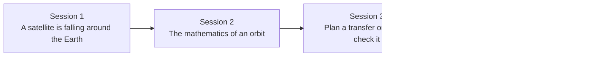

# openorbit

[](https://github.com/KrunalPanchal1995/openorbit/actions/workflows/ci.yml)   [](https://colab.research.google.com/github/KrunalPanchal1995/openorbit/blob/main/sessions/session-01/lesson.ipynb) [](https://krunalpanchal1995.github.io/openorbit/)

**Plan a satellite transfer orbit with Kepler's laws, in three sessions.**

openorbit teaches how satellites move and how to plan the cheapest simple orbit change, from falling around the Earth to a checked Hohmann transfer, using only Python and a browser.

- **Start from a falling stone.** Session 1 needs only school algebra; orbits are explained as falling and missing.
- **See it move.** Every session ships a slider app that runs in the browser, with labelled graphs.
- **Know you got it right.** Each session ends with a checkpoint that prints PASS or FAIL, and the transfer is verified by integrating the motion.
- **Build the missing half.** The repo stops at Session 3 on purpose; the roadmap shows the path to the Target.

[Target](#the-target) · [Who is this for](#who-is-this-for) · [Quick start](#quick-start) · [Sessions](#sessions) · [Roadmap](#roadmap) · [Contribute](#contribute) · [Explainer PDF](docs/explainer.pdf)

> **This repo is incomplete on purpose.** Sessions 1 to 3 are here and fully working. The finished Target below is a preview of what the community can build next. We show you the path, not the code. Sessions 4 and up are yours.

## The Target

A satellite coasts along the transfer ellipse from a low circular orbit out to the geostationary orbit. Burn markers flash at both ends, a velocity arrow follows the satellite, and two shaded wedges of equal area show Kepler's second law: the satellite sweeps the same area in the same time near the Earth and far away. On the right, delta-v bars compare a Hohmann transfer with a bi-elliptic one for two size ratios, so you can see which one wins and where. Your goal over the coming sessions: build that animation and budget yourself.


*Target: a Hohmann transfer with equal-area sweeps, and the delta-v budget against a bi-elliptic transfer*


*Target, mid-flight: equal areas swept in equal times*


*Target: the first burn leaves the low orbit*


*Target: arrival at the outer orbit after the second burn*

Try it live:

- [Math Visual Studio: open the Studio and explore more models](https://krunalpanchal1995.github.io/studio/)

How the Target was made is shown only as a path in [promo/roadmap.md](promo/roadmap.md).

## Who is this for
**secondary school to diploma / undergraduate (levels 3-5).** Topic area: Astronomy and Space Science.

Prerequisites:

- School algebra, square roots and the idea of a ratio. Sines and cosines appear in Sessions 2 and 3.
- Python 3.10 or newer; if `python --version` works, you are ready. PRIMER.md explains the rest.
- No prior GitHub, physics degree or astronomy experience is needed.

New to Python? Read [PRIMER.md](PRIMER.md) first (10 minutes).

## Quick start

No installation knowledge needed. You need [Git](https://git-scm.com/downloads) and [Python 3.10+](https://www.python.org/downloads/) (Windows: tick "Add Python to PATH"). On Mac and Linux type `python3` wherever this page says `python`.

```bash
git clone https://github.com/KrunalPanchal1995/openorbit.git
cd openorbit
python start.py 1
```

`start.py` creates a private environment, installs what is needed and runs Session 1 with its checkpoint. Next: `python start.py 2`, `python start.py 3`, or `python start.py test` to check everything. Only a checkpoint: `python start.py check 1`.

Four lines turn the idea of Session 1 into a result (they work as they are): Save it as `try.py` and run it with `python start.py run try.py` (this uses the private environment, where NumPy is installed):

```python
import numpy as np
mu = 3.986004418e14                  # Earth's gravitational parameter, m^3/s^2
r = 6371e3 + 400e3                   # radius of a 400 km high orbit, m
print(round(np.sqrt(mu / r) / 1e3, 2), 'km/s')   # -> 7.67  the speed that keeps you falling around
```

Every session also opens in your browser with sliders (no install): [live apps](https://krunalpanchal1995.github.io/openorbit/). Or use the Colab badge above for the notebook.

## Sessions

| # | Session | Model level | Time | Live app |
|---|---|---|---|---|
| 1 | [A satellite is falling around the Earth](sessions/session-01/README.md) | Level 1: conceptual interactive model | 60 min | [open](https://krunalpanchal1995.github.io/openorbit/session-01/) |
| 2 | [The mathematics of an orbit](sessions/session-02/README.md) | Level 2: mathematical engineering model | 75 min | [open](https://krunalpanchal1995.github.io/openorbit/session-02/) |
| 3 | [Plan a transfer orbit and check it](sessions/session-03/README.md) | Level 3: simulation and validation | 90 min | [open](https://krunalpanchal1995.github.io/openorbit/session-03/) |

Each session follows the same six steps: A real-world problem, B concept and theory, C visual explanation, D interactive simulation, E worked example and experiment, F assessment and design challenge. Each ends with `checkpoint.py`, which prints `PASS` or `FAIL` against reference numbers. Session 3 also contains the real-world mini-project: **Plan a transfer from a 500 km orbit to a 20200 km orbit**.

## Architecture



| Folder or file | What is inside |
|---|---|
| `sessions/` | three sessions: README (A-F), `lesson.py`, notebook, live app, exercises, activity sheet, checkpoint |
| `promo/` | the Target: media, live links, and the roadmap (path only) |
| `docs/` | `explainer.tex` and the built `explainer.pdf` |
| `tests/` | runs every lesson and checkpoint headless |
| `start.py` | one command to set up and run anything |
| `QUALITY.md`, `RUBRIC.md` | the quality checklist and the scoring rubric |
| `.github/` | CI, PDF build, Pages deploy, issue and PR templates |

## Roadmap

| Milestone | What you will build | Difficulty |
|---|---|---|
| Session 4: Split the plane change between burns | A planner that divides the 28.5 degree turn between the two burns of the GEO transfer and finds the best split. | intermediate |
| Session 5: Full rendezvous | A planner that takes a chaser and a target in circular orbits with a starting angle and returns the burns and the time to meet. | intermediate |
| Session 6: Orbit plane drift (J2) | An integrator in 3D with the J2 term added to the acceleration. | advanced |
| Session 7: Low-thrust spiral | A guidance law that steers continuous thrust along the velocity and stops at the target radius. | advanced |
| Session 8: Earth to Mars | A heliocentric planner with the Sun's gravitational parameter and circular planet orbits. | advanced |

Full detail with a checkpoint per milestone: [promo/roadmap.md](promo/roadmap.md).

## Contribute
New to GitHub? Read [CONTRIBUTING.md](CONTRIBUTING.md); it starts from zero. Pick an issue labelled `good first issue`. Translations into Hindi, Telugu, Tamil and Malayalam are welcome.

<details>
<summary>Development</summary>

```bash
python start.py test        # runs every lesson and checkpoint
```
Lessons use `# %%` cell markers so they open as notebooks in VS Code. See [QUALITY.md](QUALITY.md) for the standard every session meets.
</details>

## License
MIT. See [LICENSE](LICENSE). Media in `promo/media` is (c) Krunal Panchal, CC BY 4.0.

## Acknowledgments
Part of the [PAN IIT OSS](https://hellofoss.tech-iitb.org/projects) open-source teaching collection, modelled on the structure of [openspline](https://github.com/openspline/openspline). Built on ideas from the Math Visual Studio at https://krunalpanchal1995.github.io/studio/.
