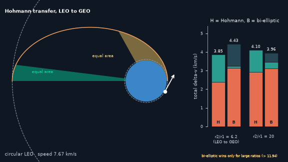
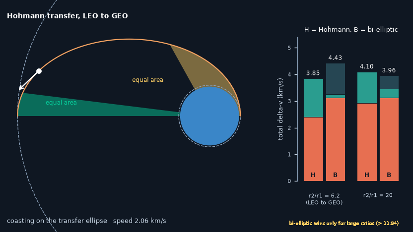
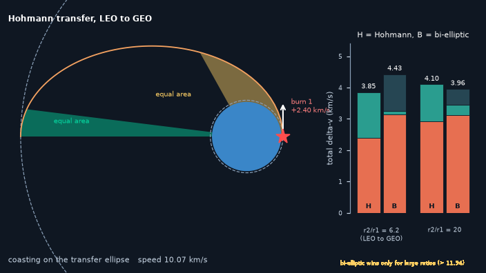
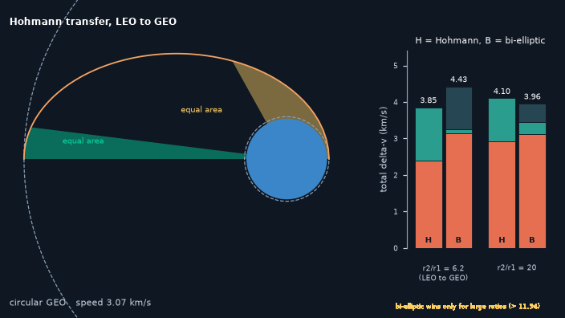

# What you are building toward

A satellite coasts along the transfer ellipse from a low circular orbit out to the geostationary orbit. Burn markers flash at both ends, a velocity arrow follows the satellite, and two shaded wedges of equal area show Kepler's second law: the satellite sweeps the same area in the same time near the Earth and far away. On the right, delta-v bars compare a Hohmann transfer with a bi-elliptic one for two size ratios, so you can see which one wins and where. Your goal over the coming sessions: build that animation and budget yourself.

*Target: a Hohmann transfer with equal-area sweeps, and the delta-v budget against a bi-elliptic transfer*

*Target, mid-flight: equal areas swept in equal times*

*Target: the first burn leaves the low orbit*

*Target: arrival at the outer orbit after the second burn*

These results come from a private reference build. The code is not published; the roadmap shows the path so you can build your own.

Live links:

- [Math Visual Studio: open the Studio and explore more models](https://krunalpanchal1995.github.io/studio/)
