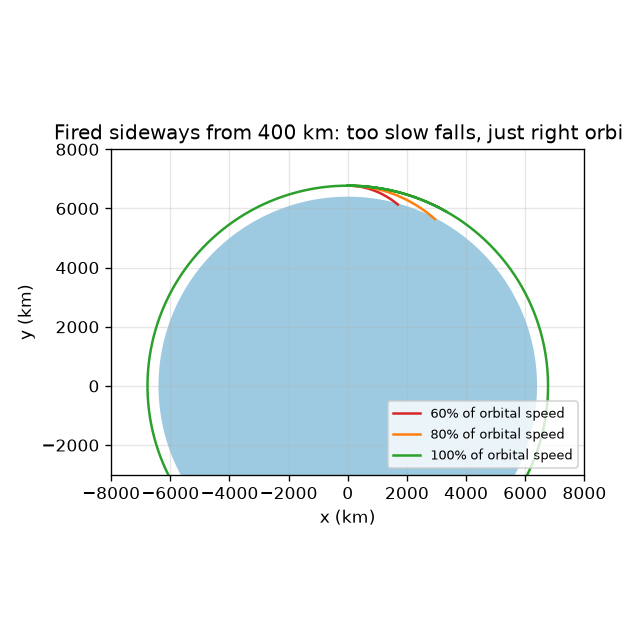
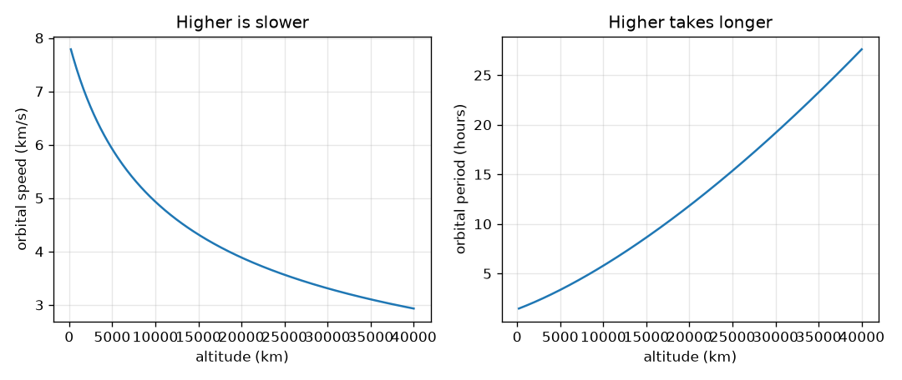

# Session 1: A satellite is falling around the Earth

*Level 1 (conceptual interactive model) · about 60 minutes · openorbit*

> This is a simplified educational model. It is not a validated design tool and must not be used for real structures, electrical installations, vehicles, industrial processes or medical decisions.

**Prerequisites**

- School algebra: squares, square roots, ratios.
- You have read PRIMER.md and run `python start.py 1` once.

**Learning objectives.** After this session you can:

- Explain why a satellite does not fall to the ground even though gravity pulls it.
- Compute the speed and period of a circular orbit at a given altitude, by hand and in Python.
- Explain why higher orbits are slower and take longer.
- State Kepler's three laws and read each as a picture.

## A. Real-world problem
A satellite has no engine pushing it along, yet it stays up for years. Why does it not drop out of the sky? The answer is that it does fall, all the time, but it moves sideways so fast that the Earth curves away beneath it as quickly as it falls. How fast is that, and how long does one lap take? Why do the International Space Station and a weather satellite take such different times to go round? Educational model: a point satellite and a perfectly round Earth.

## B. Concept and theory
Gravity at distance r from the centre of the Earth gives every object the acceleration g = mu / r^2, where mu = 3.986004418e14 m^3/s^2 is the Earth's gravitational parameter. Fire a cannonball sideways at speed v: in time t it would travel a straight line d = v t while gravity pulls it down by about 0.5 g t^2, and the round ground curves away from the straight line by r - sqrt(r^2 - d^2). When these two are equal the cannonball keeps missing the ground: that speed is v = sqrt(mu / r), and one lap takes T = 2 pi r / v. Because gravity weakens with distance, v falls as r grows, and T grows even faster. Kepler found three laws that describe every orbit: (1) orbits are ellipses with the Earth at one focus; (2) the line from the Earth to the satellite sweeps equal areas in equal times, so the satellite is fast when close and slow when far; (3) T^2 divided by a^3 is the same for all orbits around the Earth, where a is the semi-major axis (the radius for a circle).

| Symbol | Meaning | Unit |
|---|---|---|
| mu | Earth's gravitational parameter G times mass | m^3/s^2 |
| r | distance from the centre of the Earth (altitude plus 6371 km) | m |
| g | gravity acceleration at distance r | m/s^2 |
| v | speed of the satellite | m/s |
| T | time for one lap (period) | s |
| a | semi-major axis: half the long side of the ellipse | m |

**Assumptions**

- Earth is a perfect sphere of mean radius 6371 km and the satellite is a point.
- Only the Earth's gravity acts: no air drag, no Moon or Sun.
- The orbit is circular unless stated (ellipses are Session 2).

$$ g(r)=\frac{\mu}{r^{2}} $$

$$ v=\sqrt{\frac{\mu}{r}} $$

$$ T=\frac{2\pi r}{v}=2\pi\sqrt{\frac{r^{3}}{\mu}} $$

$$ \frac{T^{2}}{a^{3}}=\frac{4\pi^{2}}{\mu}\quad\text{(the same for every orbit)} $$

## C. Visual explanation
The first figure fires a cannonball sideways from 400 km height at three speeds. At 60 percent and 80 percent of the circular speed the path bends too sharply and meets the ground; at exactly the circular speed the path stays at the same height and goes round. The second figure plots circular speed and period against altitude: speed drops steadily as you go up, while the period climbs steeply, from about an hour and a half near the ground to about a day at the geostationary height.

*Fired sideways from 400 km: too slow and it falls to the ground, just right and it goes round.*

*Speed falls and period rises with altitude.*

## D. Interactive simulation
Run the lesson (`python start.py 1`), then open the live app: [Session 1: fire a satellite sideways](https://krunalpanchal1995.github.io/openorbit/session-01/) (or `app.html` in this folder). Move the altitude slider and read the period on the graph view. Then lower the launch speed below 100 percent and watch the path change from a circle into an ellipse that dips into the ground. Raise it above 100 percent and watch the far point climb.

**Challenge.** At 400 km altitude, make the satellite miss the ground (its lowest point must stay above the Earth's surface).

## E. Worked example and experiment
**Problem.** Find the speed, period and gravity for a satellite 400 km above the ground, and check that the Earth curves away as fast as the satellite falls in one second.

1. Radius r = 6371 + 400 = 6771 km = 6.771e6 m.
2. Gravity g = mu / r^2 = 3.986e14 / (6.771e6)^2 = 8.69 m/s^2 (compare 9.82 m/s^2 at the surface).
3. Speed v = sqrt(mu / r) = 7.67 km/s.
4. Period T = 2 pi r / v = 2 pi * 6771 / 7.673 = 5545 s = 92.4 min.
5. In 1 s the satellite falls 0.5 * 8.69 * 1^2 = 4.35 m. In 1 s it moves 7.67 km sideways, and the circle of radius 6771 km drops away from a straight line by 6771 - sqrt(6771^2 - 7.67^2) km = 4.35 m. The two agree.

**Answer.** v = 7.67 km/s, T = 92.4 min, g = 8.69 m/s^2, and fall and curve-away are both 4.35 m in one second.

**Experiment.** Hands-on: drop a ball from your hand and time it to confirm g near 9.8 m/s^2 at the surface. For orbits, find a pass of the International Space Station with a sky-tracking app: it crosses the sky in a few minutes and returns about every 92 minutes or so. Model versus reality: the real station is slightly higher or lower from week to week and is slowed a little by thin air, so its real period differs from the model in the third digit.

## F. Assessment and design challenge
**Question type A: Conceptual.** Astronauts on the station float. Is gravity switched off up there? Explain what 'weightless' means.

Hint

Compare gravity at 400 km with the surface value, and think about falling together.

Step-by-step solution

No. Gravity at 400 km is 8.69 m/s^2, compared with 9.82 m/s^2 at the surface, so it is still strong. The astronauts and the station fall together around the Earth with the same acceleration, so nothing pushes them against the floor. They feel weightless because they are in free fall, not because gravity is absent.

**Question type B: Numerical.** Find the speed and period of a circular orbit 1000 km above the ground. Check the sanity of your answer against the 400 km orbit.

Hint

r = 6371 + 1000 km. Use v = sqrt(mu / r) and T = 2 pi r / v.

Step-by-step solution

r = 7371 km. v = 7.35 km/s and T = 105.0 min. Sanity check: higher than the 400 km orbit, so slower (7.35 below 7.67 km/s) and a longer period (105.0 above 92.4 min). Units: km/s and minutes.

**Question type C: Graph and simulation interpretation.** In the speed and period graphs, what is the speed near 200 km and at the geostationary height, and what happens to the period? Why is the period curve steeper than the speed curve?

Hint

Read the left and right ends of both curves. Remember T = 2 pi r / v.

Step-by-step solution

At 200 km: 7.79 km/s and a period of 88.4 min. At 35786 km: 3.07 km/s and a period of 1435.7 min, about 23.93 hours. The period grows for two reasons at once: the path 2 pi r is longer, and the speed v is lower, so the period changes faster than either alone.

**Question type D: Design and optimisation challenge.** Design: an Earth-observation satellite should go round once every 100 minutes in a circular orbit. At what altitude should it fly and how fast does it move? Is the answer reasonable for a real satellite?

Hint

Solve Kepler 3 for the radius: r = (mu (T / 2 pi)^2)^(1/3) with T = 6000 s.

Step-by-step solution

r gives an altitude of 765.6 km and a speed of 7.473 km/s. This is reasonable: it is in the range of real imaging satellites, above most of the thin air that slows lower orbits. Trade-off: higher means longer lap and a wider view but a smaller picture detail; lower means sharper pictures but more drag.

Score yourself with [RUBRIC.md](../../RUBRIC.md). Print the [activity sheet](activity_sheet.md) to work on paper.

## Common misconceptions
| Common misconception | What is actually true |
|---|---|
| There is no gravity in space. | Gravity at 400 km is 8.69 m/s^2, close to the 9.82 m/s^2 at the surface. Orbiting is falling, not escaping gravity. |
| To go faster, a satellite should be higher. | Higher orbits are slower: the speed sqrt(mu / r) falls as r grows. To go up you speed up first, then you slow down on arrival. |
| A satellite needs an engine to keep going. | Once it has the right sideways speed, nothing in the model slows it, so it keeps falling around with no thrust. |
| Kepler's second law means constant speed. | It means constant area per second. When the satellite is close to the Earth it must be faster to sweep the same area. |

## Glossary
- **orbit**: the path of an object falling around another body
- **period**: time for one full lap
- **semi-major axis**: half the long side of an ellipse; equals the radius for a circle
- **altitude**: height above the ground, not the distance from the Earth's centre
- **gravitational parameter mu**: the number G times the Earth's mass; one number that sets the strength of gravity

## Finish
1. Do the three coding tasks in [exercises.md](exercises.md).
2. Run `python start.py 1` again after your changes. It ends with the checkpoint; when it prints `PASS`, you are done. (Checkpoint only: `python start.py check 1`.)

Next: [Session 2](../session-02/README.md)
