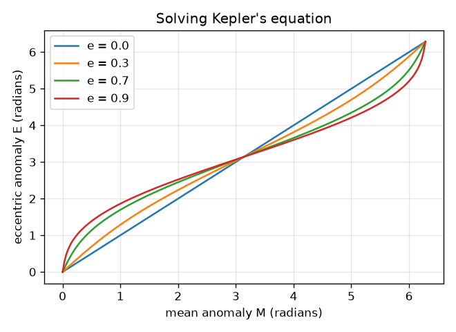
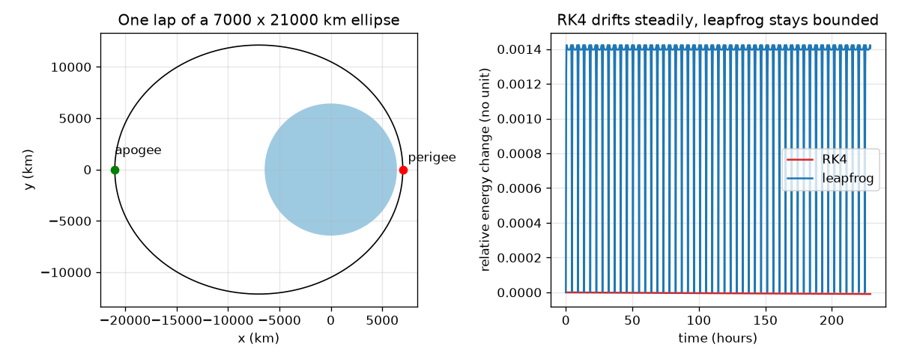

# Session 2: The mathematics of an orbit

*Level 2 (mathematical engineering model) · about 75 minutes · openorbit*

> This is a simplified educational model. It is not a validated design tool and must not be used for real structures, electrical installations, vehicles, industrial processes or medical decisions.

**Prerequisites**

- Session 1: circular speed, period and Kepler's laws.
- Square roots, and the sine and cosine of an angle in radians.

**Learning objectives.** After this session you can:

- Find the semi-major axis and eccentricity from the perigee and apogee, and use the vis-viva equation for speed.
- Show that energy and angular momentum stay constant along an orbit.
- Solve Kepler's equation by Newton iteration and check the residual.
- Compare RK4 and a symplectic (leapfrog) integrator by measuring their energy error over many laps.

## A. Real-world problem
An operator needs an orbit that dips to 500 km above the ground and climbs to 35786 km. How long is one lap? How fast is the satellite at the lowest and highest point? And where is it one hour after passing the lowest point? A circular orbit cannot answer these questions: we need ellipses. Educational model: two bodies, no drag, no Earth bulge.

## B. Concept and theory
The closest point is the perigee (radius rp) and the farthest the apogee (radius ra), both measured from the Earth's centre. The semi-major axis is a = (rp + ra) / 2 and the eccentricity is e = (ra - rp) / (ra + rp); e = 0 is a circle. Kepler 3 gives the period T = 2 pi sqrt(a^3 / mu). The speed at distance r follows from the vis-viva equation v^2 = mu (2 / r - 1 / a). Along the orbit the energy per kilogram, v^2 / 2 - mu / r = -mu / (2 a), and the angular momentum r v (sideways part) are constant, which is Kepler 2: speed is inversely proportional to distance at perigee and apogee. To locate the satellite at time t, take the mean anomaly M = 2 pi t / T. It is connected to the eccentric anomaly E by Kepler's equation M = E - e sin E, which has no closed-form solution; Newton's method E <- E - (E - e sin E - M) / (1 - e cos E) solves it in a few steps, then r = a (1 - e cos E). To check the physics we also integrate the two-body equation, acceleration = -mu r / |r|^3, with RK4 (accurate steps, but energy error that drifts) and leapfrog (a symplectic method: energy error wobbles but does not grow).

| Symbol | Meaning | Unit |
|---|---|---|
| rp, ra | perigee and apogee radius | m |
| a | semi-major axis | m |
| e | eccentricity | no unit |
| T | period | s |
| M | mean anomaly (steady clock angle) | rad |
| E | eccentric anomaly (geometric angle) | rad |
| h | specific angular momentum r v | m^2/s |
| dt | integration time step | s |

**Assumptions**

- Two point bodies, perfectly round Earth, no drag, no Moon or Sun.
- Perigee and apogee are measured from the Earth's centre: altitude + 6371 km.
- Motion stays in one plane (2D).

$$ a=\frac{r_p+r_a}{2},\qquad e=\frac{r_a-r_p}{r_a+r_p},\qquad T=2\pi\sqrt{\frac{a^{3}}{\mu}} $$

$$ v^{2}=\mu\left(\frac{2}{r}-\frac{1}{a}\right) $$

$$ \varepsilon=\frac{v^{2}}{2}-\frac{\mu}{r}=-\frac{\mu}{2a},\qquad h=r_p v_p=r_a v_a $$

$$ M=\frac{2\pi t}{T}=E-e\sin E,\qquad E_{k+1}=E_k-\frac{E_k-e\sin E_k-M}{1-e\cos E_k},\qquad r=a(1-e\cos E) $$

## C. Visual explanation
The left figure shows one lap of a 7000 by 21000 km ellipse with the perigee and apogee marked. The right figure shows the relative energy change of both integrators over 50 laps with a 60 s step: RK4 (red) drifts upward steadily, while leapfrog (blue) wobbles inside a band and stays bounded. With this step, RK4 is still more accurate: after 10 laps its energy change is 1.9e-6, after 40 laps 7.8e-6, so it grows with the number of laps, whereas the leapfrog energy error never exceeds 2e-3 but does not grow. Another figure plots the solution E of Kepler's equation against M for several eccentricities: the larger e, the more the curve bends.

*Eccentric anomaly E against mean anomaly M for several eccentricities.*

*Left: one lap of a 7000 by 21000 km orbit. Right: energy error of RK4 (drifts) and leapfrog (bounded).*

## D. Interactive simulation
Run the lesson (`python start.py 2`), then open the live app: [Session 2: design an orbit](https://krunalpanchal1995.github.io/openorbit/session-02/) (or `app.html` in this folder). Set the perigee and apogee sliders, then move the time slider to fly the satellite along the ellipse. Watch the speed on the vis-viva graph and the readout: close to the Earth it is fast, far away it is slow.

**Challenge.** Find an orbit with a period of 12 hours (within 3 minutes) for a perigee of 500 km.

## E. Worked example and experiment
**Problem.** Design the orbit with perigee altitude 500 km and apogee altitude 35786 km. Find a, e, T, the speeds at perigee and apogee, and the satellite's distance one hour after perigee.

1. rp = 6371 + 500 = 6871 km and ra = 6371 + 35786 = 42157 km.
2. a = (6871 + 42157) / 2 = 24514 km and e = (42157 - 6871) / (42157 + 6871) = 0.7197.
3. T = 2 pi sqrt(a^3 / mu) = 10.610 hours.
4. Vis-viva: perigee speed 9.988 km/s and apogee speed 1.628 km/s. Check with angular momentum: the ratio of the speeds is 6.135 and the ratio of the radii is 42157 / 6871 = 6.135.
5. Energy per kilogram = -mu / (2 a) = -8.13 MJ/kg at both ends.
6. One hour after perigee: M = 2 pi * 3600 / (10.610 * 3600) = 0.5922 rad. Newton's method gives E = 1.2821 rad in 5 iterations, so r = a (1 - e cos E) = 19491 km.

**Answer.** a = 24514 km, e = 0.7197, T = 10.610 h, perigee speed 9.988 km/s, apogee speed 1.628 km/s, and r = 19491 km one hour after perigee (E = 1.2821 rad).

**Experiment.** Hands-on: draw an ellipse on paper with two pins and a loop of string (the pins are the foci; the Earth is at one). Mark where a point moves fastest. Real-world comparison: the Earth is not a perfect sphere, so a real orbit's perigee slowly turns around, and thin air at perigee shrinks the apogee; the two-body model has neither effect, so it cannot predict a real position for many weeks.

## F. Assessment and design challenge
**Question type A: Conceptual.** Why must a satellite move faster at perigee than at apogee? Answer using both energy and angular momentum.

Hint

Compare v^2 / 2 - mu / r at two radii, and r v at two radii.

Step-by-step solution

Angular momentum h = r v is constant, so the product of radius and speed is the same at both ends: the smaller radius needs the bigger speed (the ratio of speeds equals the inverse ratio of radii, 6.135 in the worked example). In terms of energy, the satellite gains kinetic energy as it falls toward the Earth, trading it for potential energy, while the total -mu / (2 a) stays constant.

**Question type B: Numerical.** Use Kepler's third law to find the period of an orbit with semi-major axis 24514 km. Check units and compare with the geostationary period.

Hint

T = 2 pi sqrt(a^3 / mu), with a in metres.

Step-by-step solution

T = 10.610 hours. Units: metres cubed over metres cubed per second squared gives seconds squared; its root is seconds. Sanity check: smaller than the 23.93 hours at 42164 km because the semi-major axis is smaller; Kepler 3 says period grows as a^1.5.

**Question type C: Graph and simulation interpretation.** From the energy figure, which integrator would you trust for a simulation of 1000 laps, and why? Which is more accurate for 10 laps?

Hint

Look at whether each curve keeps growing or stays in a band.

Step-by-step solution

For very long runs, leapfrog: its energy error stays inside a band below 2e-3 and does not grow, and it conserves angular momentum to 1e-12. RK4's error is smaller at first (1.9e-6 after 10 laps) but grows steadily with the number of laps (7.8e-6 after 40), so over enough laps it eventually exceeds the band. The best choice depends on the number of laps and on whether a bounded error matters more than a small one.

**Question type D: Design and optimisation challenge.** Design: you need a 12 hour orbit that passes 500 km above the ground at perigee. What apogee altitude do you need, and what is the semi-major axis? How would you choose between this orbit and a circular one with the same period?

Hint

Solve Kepler 3 for a, then ra = 2a - rp.

Step-by-step solution

A period of 43200 s gives a = 26610 km, so the apogee altitude is 39978 km (apogee radius 2a - rp). A circular orbit with the same period would sit at one altitude all the time. The ellipse lingers for hours near its high point and covers the high latitudes, but flies through more radiation and needs more fuel to reach. Trade-off: coverage and dwell time versus launch cost and radiation.

Score yourself with [RUBRIC.md](../../RUBRIC.md). Print the [activity sheet](activity_sheet.md) to work on paper.

## Common misconceptions
| Common misconception | What is actually true |
|---|---|
| The Earth is at the centre of the ellipse. | The Earth is at one focus, which is why perigee and apogee differ. |
| The average of the perigee and apogee altitudes is the semi-major axis. | The semi-major axis uses distances from the Earth's centre: a = (rp + ra) / 2 with rp and ra including the Earth radius. |
| The mean anomaly is the real angle of the satellite. | M is just a steady clock angle. The geometric angle E needs Kepler's equation, and the true position needs r = a (1 - e cos E). |
| A numerical method that is accurate each step has no energy error. | Small errors accumulate. RK4 drifts steadily; leapfrog stays bounded. |

## Glossary
- **perigee**: the point of an orbit closest to the Earth
- **apogee**: the point farthest from the Earth
- **eccentricity**: how stretched an ellipse is: 0 is a circle, near 1 is very long
- **vis-viva**: the equation linking speed, distance and semi-major axis
- **symplectic integrator**: a numerical method that keeps energy error bounded, such as leapfrog
- **anomaly**: an angle that tells where the satellite is along its orbit

## Finish
1. Do the three coding tasks in [exercises.md](exercises.md).
2. Run `python start.py 2` again after your changes. It ends with the checkpoint; when it prints `PASS`, you are done. (Checkpoint only: `python start.py check 2`.)

Next: [Session 3](../session-03/README.md)
