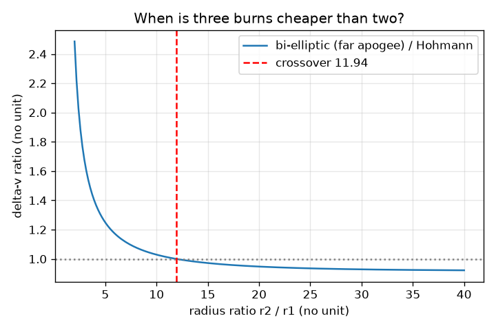
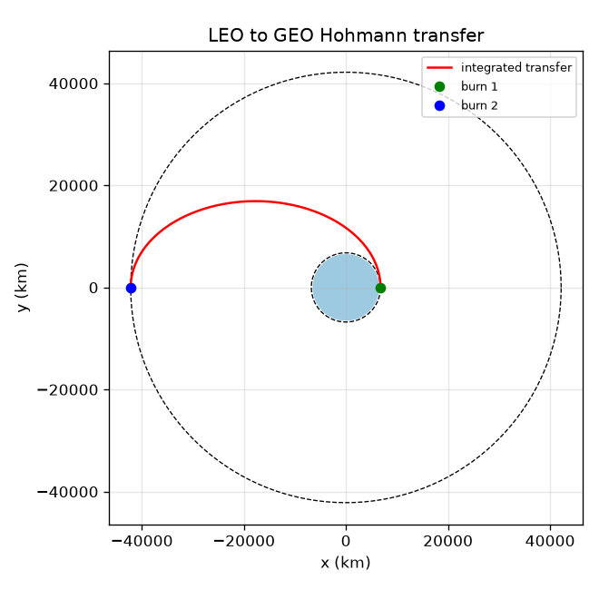
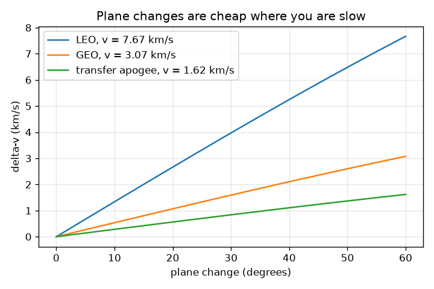

# Session 3: Plan a transfer orbit and check it

*Level 3 (simulation and validation) · about 90 minutes · openorbit*

> This is a simplified educational model. It is not a validated design tool and must not be used for real structures, electrical installations, vehicles, industrial processes or medical decisions.

**Prerequisites**

- Session 1: circular speed, period and Kepler's laws.
- Session 2: vis-viva, the ellipse, and numerical integration.

**Learning objectives.** After this session you can:

- Compute the two burns and the flight time of a Hohmann transfer between circular orbits.
- Verify the transfer by integrating the trajectory numerically from the first burn.
- Compare Hohmann with a bi-elliptic transfer and find where the cheaper choice changes.
- Price a plane change and a phasing manoeuvre, and show where the instant-burn model fails.

## A. Real-world problem
A satellite is released into a low circular orbit and must reach the geostationary orbit. Fuel is the scarcest thing on board, so every metre per second of speed change (delta-v) costs mass. What is the cheapest simple way, how long does it take, and how do we know the plan really works? Educational model: instant burns, two bodies, circular coplanar orbits. This is not a mission design tool.

## B. Concept and theory
A Hohmann transfer uses an ellipse that touches the inner circle (radius r1) at its perigee and the outer circle (radius r2) at its apogee: its semi-major axis is a_t = (r1 + r2) / 2. Burn 1 at r1 raises the speed from the circular speed to the ellipse's perigee speed; burn 2 at r2 raises it from the ellipse's apogee speed to the circular speed; both come from vis-viva. The flight takes half the period of the ellipse. A bi-elliptic transfer goes out to a far radius rb, then in to r2: three burns. For a radius ratio r2 / r1 above about 11.94 it can cost less delta-v than Hohmann, but takes much longer. Turning the velocity by an angle di without changing speed costs 2 v sin(di / 2), cheapest where v is smallest, so a plane change belongs at the apogee of the transfer, combined with the second burn at the cost sqrt(v1^2 + v2^2 - 2 v1 v2 cos di). The Oberth effect: adding delta-v to speed v adds energy v dv + dv^2 / 2 per kilogram, so the same dv gives more energy when v is high. Phasing: a chaser in a lower orbit has the higher angular rate n = sqrt(mu / r^3) and catches a target lead_deg ahead after lead / (n1 - n2). Finally, real burns take time: a weak engine burning for many minutes wastes some push as the satellite climbs (gravity loss).

| Symbol | Meaning | Unit |
|---|---|---|
| r1, r2 | radii of the inner and outer circular orbits | m |
| a_t | semi-major axis of the transfer ellipse | m |
| dv1, dv2 | the two burns | m/s |
| rb | apogee radius of the bi-elliptic transfer | m |
| di | plane change angle | degrees |
| n | angular rate sqrt(mu / r^3) | rad/s |
| dt | integration step | s |

**Assumptions**

- Burns are instant and along the velocity (the finite-burn model shows the error of this).
- Both orbits are circular and in the same plane, except in the plane change section.
- Point-mass Earth, no drag, no other bodies.
- Educational model: real mission design needs perturbations, launch windows and margins.

$$ a_t=\frac{r_1+r_2}{2},\qquad \Delta v_1=\sqrt{\mu\left(\frac{2}{r_1}-\frac{1}{a_t}\right)}-\sqrt{\frac{\mu}{r_1}},\qquad \Delta v_2=\sqrt{\frac{\mu}{r_2}}-\sqrt{\mu\left(\frac{2}{r_2}-\frac{1}{a_t}\right)} $$

$$ t_{\text{transfer}}=\pi\sqrt{\frac{a_t^{3}}{\mu}} $$

$$ \Delta v_{\text{plane}}=2v\sin\frac{\Delta i}{2},\qquad \Delta v_{\text{combined}}=\sqrt{v_1^{2}+v_2^{2}-2v_1v_2\cos\Delta i} $$

$$ \Delta\varepsilon=v\,\Delta v+\frac{\Delta v^{2}}{2},\qquad t_{\text{phase}}=\frac{\varphi}{n_1-n_2} $$

## C. Visual explanation
The first figure shows the integrated Hohmann transfer: the red path starts at the green dot on the low orbit and reaches the blue dot on the opposite side of the high orbit. The second plots the delta-v of a bi-elliptic transfer divided by that of Hohmann against the radius ratio: the curve crosses 1 at 11.94, with Hohmann cheaper to the left and bi-elliptic cheaper to the right; at ratio 5 it costs 1.249 times as much, at 10 it is 1.029, at 15 it is 0.972. The third shows the plane change cost for three speeds: the slow transfer apogee is the cheapest place to turn.

*Bi-elliptic delta-v divided by Hohmann delta-v: crossover at a radius ratio of about 11.94.*

*The integrated LEO to GEO Hohmann transfer: it arrives on the far side of the outer orbit.*

*Plane change cost against angle at three speeds: slow is cheap.*

## D. Interactive simulation
Run the lesson (`python start.py 3`), then open the live app: [Session 3: Hohmann against bi-elliptic](https://krunalpanchal1995.github.io/openorbit/session-03/) (or `app.html` in this folder). Choose the inner altitude and the radius ratio and read the two burns and the transfer time. Then move the bi-elliptic apogee slider and switch to the graph view to see where the green curve crosses the blue one.

**Challenge.** Find a transfer where the bi-elliptic route is cheaper than the Hohmann route.

## E. Worked example and experiment
**Problem.** Plan the Hohmann transfer from a circular orbit of radius 6778 km (a low orbit) to the geostationary radius 42164 km. Find both burns, the total, and the flight time, and verify them by integration.

1. a_t = (6778 + 42164) / 2 = 24471 km.
2. Speeds: circular at 6778 km is 7.669 km/s, the transfer's perigee speed is 10.066 km/s, the transfer's apogee speed is 1.618 km/s, and the circular speed at 42164 km is 3.075 km/s.
3. dv1 = 10.066 - 7.669 = 2.398 km/s. dv2 = 3.075 - 1.618 = 1.457 km/s. Total = 3.854 km/s.
4. Transfer time = half the period of the ellipse = 5.291 hours.
5. Numerical check: start at 6778 km, speed 10.066 km/s, integrate for 5.291 hours with RK4. The satellite arrives at radius 42164 km (within 1 km), on the opposite side of the Earth (180 degrees), moving at 1618 m/s. After adding dv2 the orbit stays circular to within 1 m for a whole lap.

**Answer.** dv1 = 2.398 km/s, dv2 = 1.457 km/s, total 3.854 km/s (about 3.9), flight time 5.291 h (about 5.3 h), confirmed by integration to within 1 km.

**Experiment.** Hands-on: spin a small ball on a string, then let out the string to a longer length and notice it slows down: the same trade as an orbit. Real-world comparison: real transfers to the geostationary orbit use a launch inclination of about the site's latitude, and the second burn also turns the orbit into the equatorial plane. Engines do not burn instantly, and the burn happens around perigee in several smaller burns, so the real total is a little higher than 3.854 km/s. The model is a lower bound for the simple case.

## Real-world application and mini-project: Plan a transfer from a 500 km orbit to a 20200 km orbit
A navigation satellite is released into a circular orbit 500 km above the ground and must reach a circular orbit 20200 km above the ground. Use `hohmann` and `check_hohmann` from Session 3 (altitudes are measured from the ground, so add the Earth radius 6371 km to get orbit radii). Report both burns, the transfer time, and the result of the numerical check. Also show that a bi-elliptic route with an apogee of three times the final radius is more expensive here.

**Deliverable:** A script that prints dv1, dv2, the total delta-v, the transfer time in hours, the integrated arrival radius and angle, and the bi-elliptic total for comparison.

**Success looks like:** Delta-v is 1984.8 m/s for burn 1, 1390.3 m/s for burn 2 and 3375.1 m/s in total; the transfer takes 2.989 hours; the integrated trajectory arrives within 1 km of the outer radius on the opposite side of the Earth (180 degrees); and the bi-elliptic total is larger.

## F. Assessment and design challenge
**Question type A: Conceptual.** Why are both Hohmann burns along the velocity (tangential), and why is the flight time half an ellipse period?

Hint

The transfer ellipse touches both circles at its two ends; think about the directions of the velocities there.

Step-by-step solution

The ellipse is tangent to both circles at perigee and apogee, where the velocity is perpendicular to the radius for both curves. So the speed must change in size, not direction, which is a tangential burn. The satellite goes from perigee to apogee, which is half the ellipse and so half its period.

**Question type B: Numerical.** Find the Hohmann burns and the transfer time between the circular orbits of radius 6778 km and 7178 km (a small step, for example before docking).

Hint

a_t = (r1 + r2) / 2, then use vis-viva as in the worked example.

Step-by-step solution

dv1 = 109.1 m/s, dv2 = 107.6 m/s, total 216.7 m/s, transfer time 2900.5 s. Sanity check: a 400 km step costs little, and the two burns are nearly equal. Units: metres per second and seconds.

**Question type C: Graph and simulation interpretation.** In the bi-elliptic graph, for which radius ratios is Hohmann cheaper, and what does the 11.94 crossing mean for LEO to GEO?

Hint

Read where the curve is above and below 1 and compute the LEO to GEO ratio.

Step-by-step solution

Hohmann is cheaper to the left of 11.94 (the ratio 5 costs 1.249 times more with a bi-elliptic transfer, and 10 costs 1.029 times more); bi-elliptic is cheaper to the right (0.972 at 15). LEO to GEO has a ratio of 42164 / 6778 = 6.22, which is to the left, so Hohmann wins: a bi-elliptic with an apogee of 20 r2 costs 4.427 km/s and takes 32.9 days, against 3.854 km/s and 5.291 hours.

**Question type D: Design and optimisation challenge.** Design: a satellite is launched into a low orbit inclined 28.5 degrees and must be put into the equatorial geostationary orbit. Compare three plans for the plane change: in the low orbit, at the geostationary orbit, and combined with the second burn at the transfer apogee. Which would you choose and what is the trade-off?

Hint

Use 2 v sin(di / 2) with v = 7.669, 3.075 km/s, and the combined formula with 1.618 and 3.075 km/s.

Step-by-step solution

Turn in the low orbit: 3.775 km/s + 3.854 km/s = 7.629 km/s. Turn at the geostationary orbit: 3.854 + 1.514 = 5.368 km/s. Combined at apogee: 2.398 + 1.824 = 4.222 km/s. Combine with the second burn: the turn is done where the speed is lowest (1.618 km/s) and the burn serves two purposes at once. Trade-off: the one-burn plan needs the engine to point away from the velocity, and any error in direction misses the target plane, so a real plan often splits the turn between burns.

Score yourself with [RUBRIC.md](../../RUBRIC.md). Print the [activity sheet](activity_sheet.md) to work on paper.

## Common misconceptions
| Common misconception | What is actually true |
|---|---|
| To reach a higher orbit, burn straight up. | You burn along the velocity to raise the opposite side of the orbit; a satellite given a push 'up' just changes its ellipse in a way that costs more. |
| The second burn slows the satellite down. | At apogee the satellite is slower than the circular speed there, so burn 2 speeds it up, even though the final orbit is slower than the first. |
| Bi-elliptic is always a clever saving. | It only wins above a radius ratio of about 11.94 and costs a lot more time; below that, Hohmann is cheaper and faster. |
| An impulsive burn is what a real engine does. | A real engine burns for seconds to hours; during that time gravity keeps bending the path, which costs extra delta-v (gravity loss). |

## Glossary
- **delta-v**: total change in speed that the engines must provide; the fuel budget in m/s
- **Hohmann transfer**: the two-burn transfer along an ellipse touching both circles
- **bi-elliptic transfer**: a three-burn transfer through a far apogee
- **phasing**: changing orbits to arrive at the same place as another satellite
- **gravity loss**: extra delta-v needed because a long burn fights gravity as it climbs
- **impulsive burn**: the simplification that a burn is instant

## Finish
1. Do the three coding tasks in [exercises.md](exercises.md).
2. Run `python start.py 3` again after your changes. It ends with the checkpoint; when it prints `PASS`, you are done. (Checkpoint only: `python start.py check 3`.)

Next: the [roadmap](../../promo/roadmap.md). Session 4 is yours to build.
